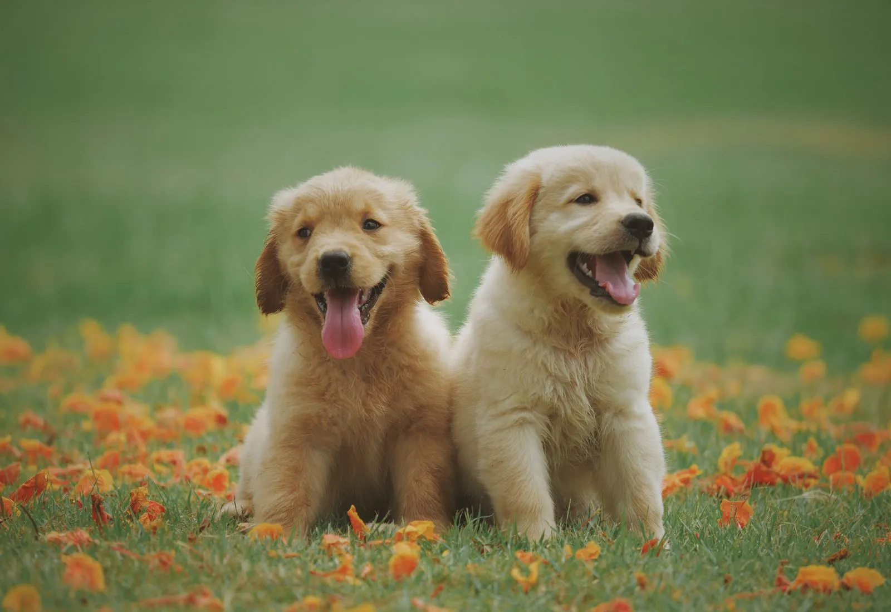

  
A DIGITAL NEIGHBOURHOOD FOR SECOND CHANCES

  <h1>Adopt a Buddy</h1>
  
<strong>Life gets bigger when someone small joins it.</strong>

  
A story-led pet adoption experience where thoughtful families meet dogs, cats, and wonderfully unexpected companions.

  

    
    
    
    
    
  

  

    <a href="#enter-the-story">Enter the story</a> &nbsp;&middot;&nbsp;
    <a href="#the-walk-home">The walk home</a> &nbsp;&middot;&nbsp;
    <a href="#run-it">Run it</a> &nbsp;&middot;&nbsp;
    <a href="#inside-the-build">Inside the build</a>
  

 

  

---

## Enter the story

Most adoption websites begin with a grid. Adopt a Buddy begins with a feeling:
the small, uncertain hello that can quietly change an everyday life.

The experience unfolds like a warm neighbourhood storybook. Real listings stay
clear and practical. Original illustration, typography, sound, and motion build
the emotional bridge around them.

~~~text
A first look  ->  a little trust  ->  a shared rhythm  ->  an ordinary home
~~~

> [!TIP]
> Use the **Sound off** control on the homepage when you want the full ambient
> experience. Sound always starts off and never carries essential information.

### Choose your path

| I want to... | Start here |
| --- | --- |
| Meet a possible companion | Open **Meet the buddies**, then filter by name, species, breed, or city |
| Help a pet find a home | Create a caregiver account and publish an honest, photo-led listing |
| Understand the creative system | Explore [the design documentation](./docs/design/README.md) |
| Study the engineering | Jump to [Inside the build](#inside-the-build) |

## The walk home

The signature chapter is a reversible GSAP scroll narrative. A person and dog
begin apart, discover a shared walking rhythm, play, and arrive at a small home.
The animation is connected to the visitor's pace rather than played at them.

~~~mermaid
flowchart LR
    H["01 First hello"] --> T["02 A little trust"]
    T --> W["03 Your walk"]
    W --> P["04 Play"]
    P --> B["05 Belonging"]

    classDef quiet fill:#fffaf0,stroke:#172c55,color:#172c55,stroke-width:2px;
    classDef warm fill:#f4bd2e,stroke:#172c55,color:#172c55,stroke-width:2px;
    classDef heart fill:#d94b39,stroke:#172c55,color:#fffaf0,stroke-width:2px;
    class H,T quiet;
    class W,P warm;
    class B heart;
~~~

<strong>How the scene moves</strong>

- **ScrollTrigger** pins one cinematic desktop chapter and scrubs a single timeline.
- **DrawSVG** reveals the route as the relationship develops.
- **MotionPath** gives the ball one purposeful arc.
- Character transforms stay reversible when the visitor scrolls back.
- Mobile devices receive the complete story in natural document flow.
- Reduced-motion visitors receive every chapter as a readable static sequence.

<strong>How sound behaves</strong>

The 18-second ambient loop is synthesized locally and has no third-party asset
dependency. Howler loads it only after direct interaction, fades it in and out,
pauses it when the tab is hidden, and unloads it when the component leaves.

## What feels different

| Layer | Design decision | Product reason |
| --- | --- | --- |
| Art direction | Tactile clay and layered-paper scenes | Warmth without presenting generated art as a real pet |
| Typography | Fraunces with DM Sans | Editorial emotion with practical readability |
| Colour | Paper, cobalt, tomato, marigold, leaf | Optimistic, distinctive, and grounded |
| Motion | One narrative timeline plus restrained reveals | A memorable story without scroll hijacking |
| Pet cards | Real photographs and visible facts | Trust stays more important than decoration |
| Empty/error states | Direct language and intentional illustrations | The experience remains coherent when data is absent |
| Audio | Optional, local, and user activated | Atmosphere without surprise or dependency risk |

The artwork and its generation briefs are in [the asset ledger](./docs/design/assets.md).
The tokens and components are in [the visual system](./docs/design/system.md), and
the animation contract is in [the motion system](./docs/design/motion.md).

## The product

| Future families | Caregivers | Trust |
| --- | --- | --- |
| Browse without an account | Create a seller account | HTTP-only, same-site cookies |
| Search by pet or place | Upload photos and stories | bcrypt and JWT sessions |
| Read the complete profile | Edit owned listings | Role and ownership guards |
| Contact the caregiver | Manage a private dashboard | DTO validation and Helmet |

## Run it

### Local development

You need **Node.js 20+** and **MongoDB**.

~~~powershell
git clone <your-repo-url> adopt-a-buddy-place
cd adopt-a-buddy-place

npm install
npm --prefix frontend install
npm --prefix backend install

Copy-Item backend/.env.example backend/.env
# Add a MongoDB MONGODB_URI and a strong JWT_SECRET.

npm --prefix backend run seed   # optional: load demo pets and a seller account
npm run dev
~~~

The seed loads twelve example listings and a demo caregiver account
(`caregiver@adoptabuddy.local` / `DemoPass123!`). It is idempotent, so you can
re-run it to reset the sample data.

| Surface | Local address |
| --- | --- |
| Story-led web experience | [localhost:3000](http://localhost:3000) |
| API health | [localhost:5000/api/health](http://localhost:5000/api/health) |

The launcher checks ports 3000 and 5000, starts both services, and stops them together.

<strong>Run each service separately</strong>

~~~powershell
npm --prefix frontend run dev
npm --prefix backend run dev
~~~

### Docker Compose

~~~powershell
Copy-Item .env.example .env
# Replace the local example password and JWT secret.

docker compose up --build
~~~

Compose starts the web app, API, and MongoDB. The demo seed runs before the API
starts, so the site opens with example pets and the demo caregiver account
(`caregiver@adoptabuddy.local` / `DemoPass123!`). Database records and uploaded
images persist in named volumes.

> [!IMPORTANT]
> The example credentials are only for local development. Replace every example
> secret before exposing the application.

## Inside the build

~~~mermaid
flowchart LR
    V["Visitor or caregiver"] --> W["React 19 Vite SPA"]
    W -->|"/api + /uploads"| A["Express REST API"]
    W --> M["GSAP story Howler ambience"]
    A --> G{"Authentication role + ownership"}
    G --> P["Mongoose 8"]
    P --> D[("MongoDB")]
    A --> U[("Image uploads")]

    classDef person fill:#f8f0dc,stroke:#172c55,color:#172c55,stroke-width:2px;
    classDef experience fill:#f4bd2e,stroke:#172c55,color:#172c55,stroke-width:2px;
    classDef service fill:#d94b39,stroke:#172c55,color:#fffaf0,stroke-width:2px;
    classDef data fill:#dbe9ff,stroke:#154a91,color:#172c55,stroke-width:2px;
    class V person;
    class W,M experience;
    class A,G service;
    class P,D,U data;
~~~

| Layer | Tools |
| --- | --- |
| Experience | React 19, Vite, TypeScript, React Router |
| Motion and sound | GSAP, ScrollTrigger, MotionPath, DrawSVG, @gsap/react, Howler |
| API | Express, Zod validation, Helmet |
| Data | Mongoose 8, MongoDB 7 |
| Authentication | bcryptjs, JWT, HTTP-only cookies |
| Operations | Docker Compose, dual-service launcher |

<strong>Project map</strong>

~~~text
adopt-a-buddy-place/
|-- .21st/                  # Machine-readable design context
|-- docs/design/            # Visual, motion, and asset decisions
|-- frontend/
|   |-- index.html          # Vite entry
|   |-- src/
|   |   |-- pages/          # Home, pets, detail, auth, dashboard routes
|   |   |-- components/     # Story, cards, forms, auth, and dashboard
|   |   +-- lib/            # Typed API boundary
|   +-- public/art/         # Pet photos and compressed artwork
|   +-- public/audio/       # Optional ambient loop
|-- backend/
|   +-- src/
|       |-- models/         # Mongoose schemas (User, Pet)
|       |-- routes/         # Auth, pets, uploads
|       |-- middleware/     # Auth + role guards
|       +-- server.js       # Express app + Mongo connection
|-- scripts/                # Port guard and audio generator
|-- docker-compose.yml
+-- README.md
~~~

<strong>API map</strong>

| Method | Route | Access | Purpose |
| --- | --- | --- | --- |
| POST | /api/auth/register | Public | Create a buyer or seller account |
| POST | /api/auth/login | Public | Start a cookie-based session |
| POST | /api/auth/logout | Public | End the current session |
| GET | /api/auth/me | Signed in | Return the current user |
| GET | /api/pets | Public | Browse and filter listings |
| GET | /api/pets/:id | Public | Read one pet profile |
| POST | /api/pets | Seller | Publish a listing |
| PUT | /api/pets/:id | Owner | Update an owned listing |
| DELETE | /api/pets/:id | Owner | Remove an owned listing |
| POST | /api/pets/upload-image | Seller | Upload a listing photograph |
| GET | /api/health | Public | Check API availability |

## Quality gates

~~~powershell
# Frontend production build (type-checks, then bundles with Vite)
npm run build

# Frontend
npm --prefix frontend run typecheck

# Backend (seed the demo data)
npm --prefix backend run seed
~~~

The interface is tested at desktop and mobile widths, includes a reduced-motion
path, keeps sound optional, and provides designed loading, empty, error, and
API-unavailable states.

---

  
<strong>A familiar footstep. A warm patch of floor. Someone waiting when you come home.</strong>

  
Designed and engineered as a small argument for more thoughtful digital adoption.

